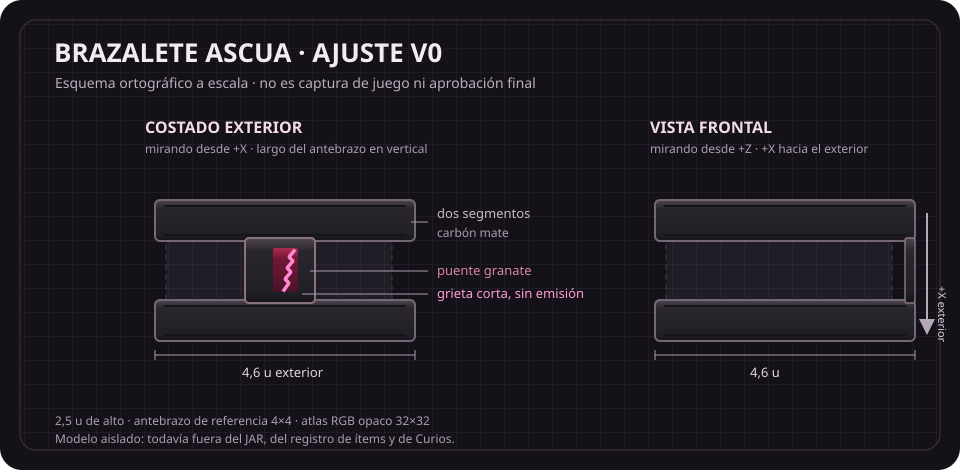

# Brazalete Ascua — prototipo de ajuste v0

[Esquema ortográfico](esquema.svg) · [Proyecto Blockbench](Brazalete_Ascua_fit_v0.bbmodel) · [Atlas 32×32](brazalete_ascua.png) · [Generador reproducible](../../../tools/prototype_brazalete_ascua.py).

Este primer volumen sigue la propuesta de `docs/ACCESORIOS_BLIGHT_STAR.md`: dos segmentos de carbón, un puente granate y una grieta rosa corta en el costado exterior. El brazalete mide **2,5 unidades de alto**, envuelve un antebrazo de referencia de 4×4 y deja el puente en la cara exterior. El atlas es RGB opaco de 32×32; la grieta **no** tiene glowmask ni pase emisivo.

## Límite de este prototipo

Es geometría aislada para revisar silueta y ajuste en Blockbench. **No forma parte del JAR**: no se agregó al GEO del manto, al registro de ítems, a Curios ni a ningún renderer. Tampoco tiene animaciones, chispas o giro propio. El modelo usa un pivote local de antebrazo izquierdo con `+X` hacia afuera y `+Z` hacia delante; esa orientación todavía necesita confirmarse con Steve y Alex antes de integrarlo.

## Siguiente revisión visual

Antes de registrar un slot, revisar en Blockbench/Forge:

- tres cuartos frontal, dorso y perfil;
- Steve y Alex, manga base y manga exterior;
- brazo en reposo, ataque, nado y sosteniendo un objeto;
- holgura con pechera y el manto al correr.

El JSON del proyecto, el enlace de los 15 cubos y la imagen PNG embebida se validaron localmente. **La forma no se ha aprobado visualmente ni se ha probado en Forge.**