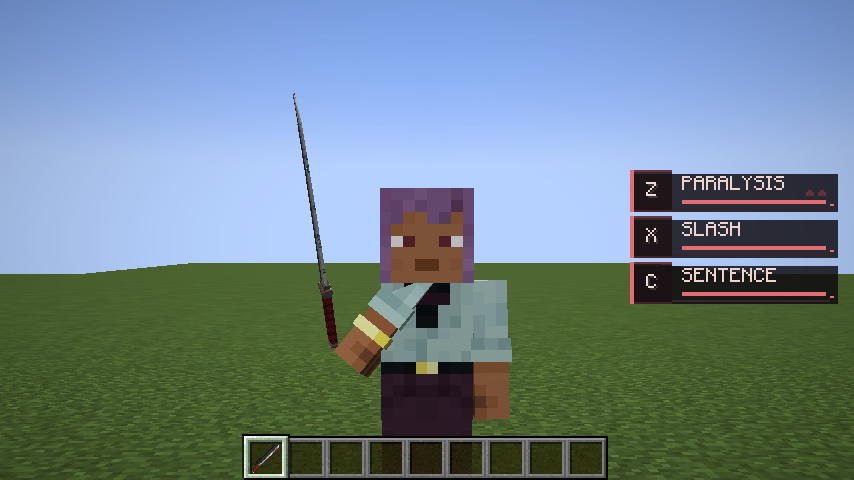
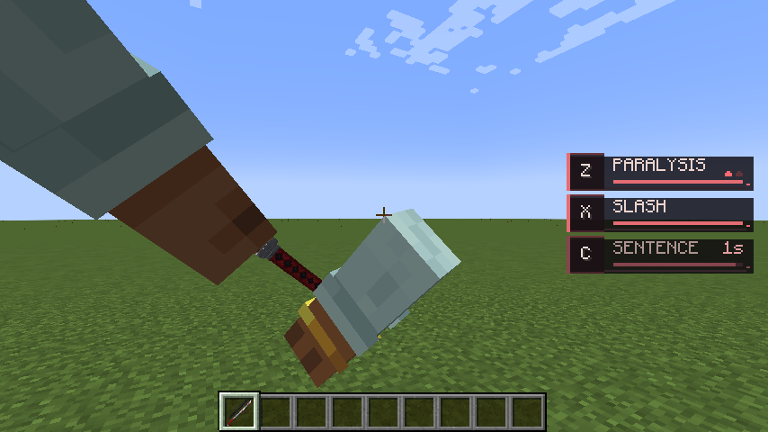
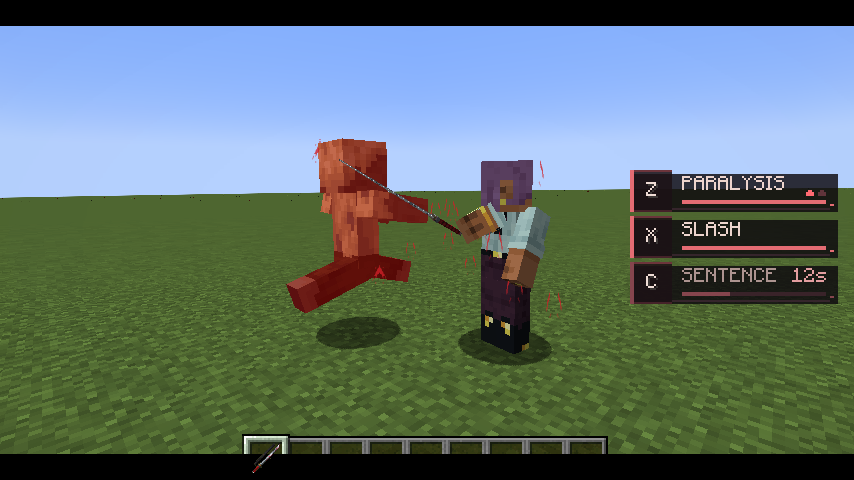
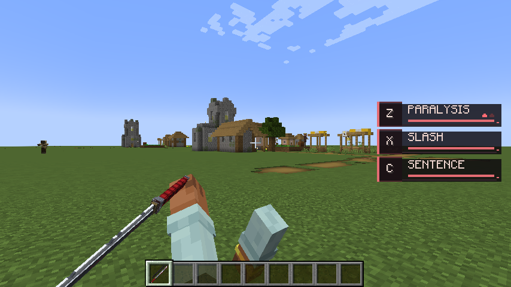
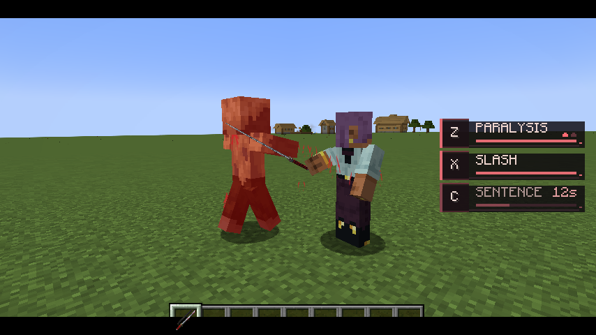

# Galería de pruebas de la katana de Stain

Estas imágenes son capturas automáticas de un cliente Forge de prueba, **no un video ni un playtest**. Los fotogramas aislados no garantizan continuidad de la animación, calidad del agarre, sonido ni compatibilidad con todos los mods. Las carpetas se actualizan cuando termina el workflow visual; pueden reflejar una prueba experimental posteriormente descartada y no necesariamente el código actual.

**Estado de revisión:** la guardia aparece al costado en los ensayos recientes, pero todavía no está aprobada. En Z los brazos zurdos siguen viéndose separados o solapados; en X se probó un encuadre más bajo y aún debe revisarse la continuidad. La coreografía de C sigue siendo repetitiva y no está aprobada. Ninguna de estas capturas equivale a una aceptación visual o un playtest.

**Último ensayo visual:** workflow `45443052143` y compilación `45443049897`, ambos exitosos. Se descartó la prueba simétrica anterior porque ocultaba la espada y los brazos zurdos. Las imágenes se regeneraron con el encuadre anterior, que aún tiene defectos. Los impactos se capturan después del evento de daño, no necesariamente en el mismo fotograma.

## Con Better Combat instalado

[Ver todas las capturas](client-full-bc/) · [Tiempos de captura](client-full-bc/capture-timing.tsv)

### Guardia de frente
[Diestro](client-full-bc/04_third_front.png) · [Zurdo](client-full-bc/00c_left_guard_front.png) · [Zurdo desde atrás](client-full-bc/00a_left_third.png)

### Z, primera persona: diestro y zurdo

### C: impactos confirmados por el servidor

Cada captura se solicita después de un evento de daño confirmado; la sincronización exacta de red y de render puede variar. [Impacto 1](client-full-bc/confirmed_c_impact_01.png) · [2](client-full-bc/confirmed_c_impact_02.png) · [3](client-full-bc/confirmed_c_impact_03.png) · [4](client-full-bc/confirmed_c_impact_04.png) · [5](client-full-bc/confirmed_c_impact_05.png) · [6](client-full-bc/confirmed_c_impact_06.png) · [7](client-full-bc/confirmed_c_impact_07.png) · [8](client-full-bc/confirmed_c_impact_08.png) · [9](client-full-bc/confirmed_c_impact_09.png) · [10](client-full-bc/confirmed_c_impact_10.png)

### X: primera persona
[Preparación diestra](client-full-bc/86_x_first_prepare.png) · [Impacto diestro](client-full-bc/88_x_first_impact.png) · [Preparación zurda](client-full-bc/101_x_left_first_prepare.png) · [Impacto zurdo](client-full-bc/103_x_left_first_impact.png)

## Sin Better Combat

[Ver todas las capturas](client-vanilla/) · [Tiempos de captura](client-vanilla/capture-timing.tsv)

**C sigue en desarrollo: los contactos mejoraron en algunos fotogramas, pero las poses aún no están aprobadas.**

## Recursos de animación de Better Combat sin el mod completo

[Ver todas las capturas](client-test/) · [Tiempos de captura](client-test/capture-timing.tsv)
