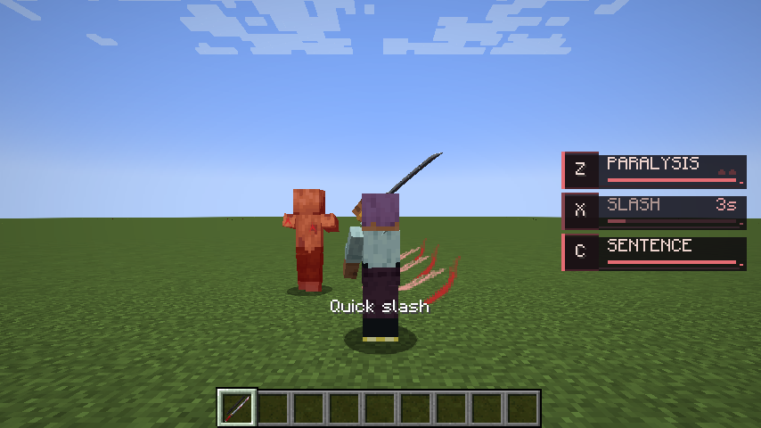

# Galería de pruebas de la katana de Stain

Estas imágenes son capturas automáticas de un cliente Forge de prueba, **no un video ni un playtest**. Los fotogramas aislados no garantizan continuidad de la animación, calidad del agarre, sonido ni compatibilidad con todos los mods. Las carpetas se actualizan cuando termina el workflow visual; pueden reflejar una prueba experimental posteriormente descartada y no necesariamente el código actual.

**Estado de revisión:** la guardia y la primera persona siguen rechazadas: la espada cruza la cara y hay brazos separados o agarres incorrectos. Los cortes de C tampoco están aprobados: en los impactos 4 y 7 la hoja todavía parece una guardia levantada. Las capturas no son una versión final.

**Último ensayo visual:** workflow `45076866783`, sobre la versión con las pruebas de selección de animaciones. Las tres ejecuciones del cliente, incluida la verificación de que Better Combat resolvió los cuatro clips externos, terminaron correctamente; el paso final de guardar imágenes terminó con error, aunque las capturas se publicaron en el commit `698e9926`. La compilación `45076866765` pasó. Estos resultados no aprueban visualmente las poses ni prueban el movimiento completo.

La prueba anterior (`45075610731`) abrió más el brazo de la guardia y adelantó el contacto de C: la hoja terminó atravesando la cara y otros golpes se veían de canto. Ambos cambios se revirtieron antes del ensayo más reciente.

## Con Better Combat instalado

[Ver todas las capturas](client-full-bc/) · [Tiempos de captura](client-full-bc/capture-timing.tsv)

### Guardia de frente

### Z, primera persona: diestro y zurdo

### C: impactos confirmados por el servidor

Cada captura se solicita después de un evento de daño confirmado; la sincronización exacta de red y de render puede variar. [Impacto 1](client-full-bc/confirmed_c_impact_01.png) · [2](client-full-bc/confirmed_c_impact_02.png) · [3](client-full-bc/confirmed_c_impact_03.png) · [4](client-full-bc/confirmed_c_impact_04.png) · [5](client-full-bc/confirmed_c_impact_05.png) · [6](client-full-bc/confirmed_c_impact_06.png) · [7](client-full-bc/confirmed_c_impact_07.png) · [8](client-full-bc/confirmed_c_impact_08.png) · [9](client-full-bc/confirmed_c_impact_09.png) · [10](client-full-bc/confirmed_c_impact_10.png)

### X: ejemplo de impacto

## Sin Better Combat

[Ver todas las capturas](client-vanilla/) · [Tiempos de captura](client-vanilla/capture-timing.tsv)

**C sigue en desarrollo: las poses de impacto aún no están aprobadas.**

## Recursos de animación de Better Combat sin el mod completo

[Ver todas las capturas](client-test/) · [Tiempos de captura](client-test/capture-timing.tsv)
