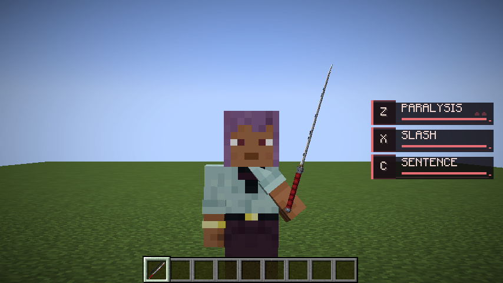
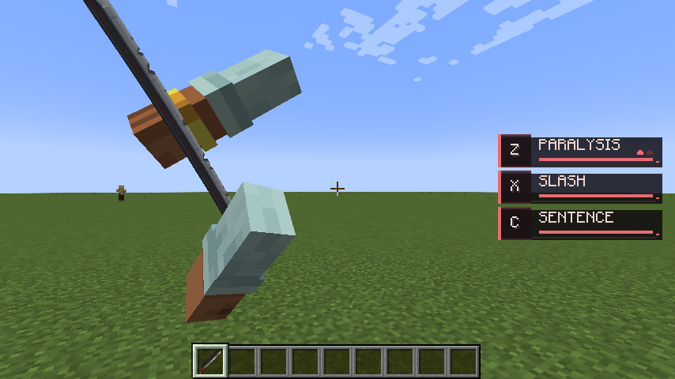
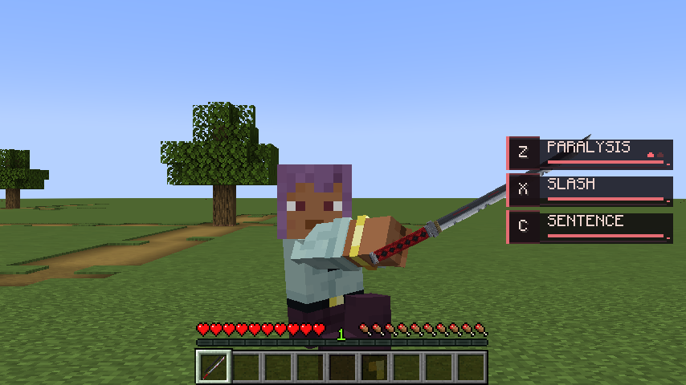
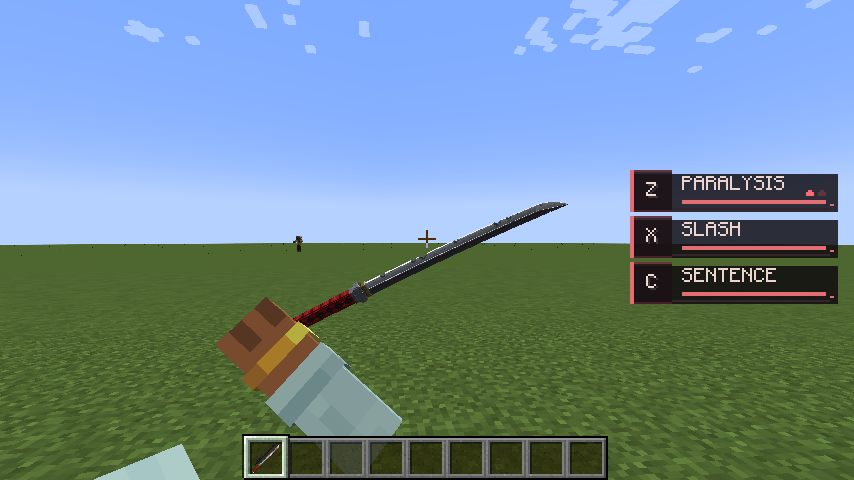

# Galería de pruebas de la katana de Stain

Estas imágenes son capturas automáticas de un cliente Forge de prueba, **no un video ni un playtest**. Los fotogramas aislados no garantizan continuidad de la animación, calidad del agarre, sonido ni compatibilidad con todos los mods. Las carpetas se actualizan cuando termina el workflow visual; pueden reflejar una prueba experimental posteriormente descartada y no necesariamente el código actual.

**Estado de revisión:** la guardia aparece al costado en los ensayos recientes, pero todavía no está aprobada. En Z los brazos zurdos siguen viéndose separados o solapados; en X se probó un encuadre más bajo y aún debe revisarse la continuidad. La coreografía de C ganó variedad (cuatro cortes laterales rotan deterministamente) pero la compensación de agarre sigue sin aprobarse y faltan revisión en movimiento, ambas manos y sincronización bajo latencia. Ninguna de estas capturas equivale a una aceptación visual o un playtest.

**Último ensayo visual:** workflow `45543014805` (clientes con Better Combat, sin él y con sus clips como recurso; verificación del fixture y del encuadre de brazos superadas) y compilación `45544081949` (JAR 0.22.0-test, verificación de assets y del servidor Forge superadas). Se comprobaron las imágenes 124–139 de las variantes laterales de C: los cortes de Serious Player Animations conservan empuñadura razonable en la anticipación; los cortes de Kelvin muestran dos manos conectadas en la anticipación pero el remate queda oculto de frente o bajo, y el clip de Serious #2 (trial2) termina con la hoja a la altura de la cintura. La hipótesis de espejo (+45°) para la guardia zurda en tercera persona se midió y revisó: en la vista trasera la hoja cruzaba la espalda, así que **se revirtió**; esa regresión ya no está en el árbol. Se conserva el defecto de Z zurdo en primera persona. Ninguna corrección está aprobada y los problemas visuales siguen pendientes. Los impactos se capturan después del evento de daño, no necesariamente en el mismo fotograma.

**Estas capturas y los enlaces de esta galería corresponden a la rama `arena/ce4979c1-modelos`**, donde se prepara y se publicó la versión 0.23.0-test (SHA-256 `2ecd6918…`, build verde `45551864727`); el árbol ya es 0.26.0-test (sin mensajes ni tarjetas; HUD compacto; fixture sigue con capturas de 0.23/0.24 — los cortes se regeneraron con rightItem constante). El enlace de `arena/a09d390b-modelos` solo muestra las imágenes antiguas hasta que este trabajo se fusione allí. Las muestras 124–139 siguen representando los mismos clips que antes: la rotación lateral de C amplía sus slots 4–5 con `kelvin_swing_first_sneak` y `kelvin_swing_second_sneak` (Kelvin, MIT). El árbol además añade sacudida de cámara por golpe, rim flash carmesí y tarjeta de título en la ejecución decisiva de C y Z — ninguna de estas cosas está validada en juego humano; ninguna imagen equivale a aceptación visual.

## Con Better Combat instalado

[Ver todas las capturas](client-full-bc/) · [Tiempos de captura](client-full-bc/capture-timing.tsv)

### Guardia de frente
[Diestro](client-full-bc/04_third_front.png) · [Zurdo](client-full-bc/00c_left_guard_front.png) · [Zurdo desde atrás](client-full-bc/00a_left_third.png)

### Z, primera persona: diestro y zurdo

### C: variantes laterales (ensayo 0.22.0-test, muestras aisladas)

Los cortes laterales de C alternan: `stain_c_grip_trial` (Serious `sword_attack2`), `stain_c_grip_trial2` (Serious `sword_attack`, compensación escalada a 0.875 s), `kelvin_swing_first` y `kelvin_swing_second` (Kelvin's Better Player Animations, estirados a 0.9 s). El octavo golpe de C (id 16) no animaba en versiones anteriores por un error de límites; corregido. Estas son muestras locales sin víctima; ninguna fase ni sincronía está aprobada.

[Preparación trial2](client-full-bc/124_c_trial2_prepare.png) · [Anticipación trial2](client-full-bc/125_c_trial2_windup.png) · [Contacto trial2](client-full-bc/126_c_trial2_contact.png) · [Recuperación trial2](client-full-bc/127_c_trial2_recover.png)

[Preparación kelvin1](client-full-bc/128_c_kelvin1_prepare.png) · [Anticipación kelvin1](client-full-bc/129_c_kelvin1_windup.png) · [Contacto kelvin1](client-full-bc/130_c_kelvin1_contact.png) · [Recuperación kelvin1](client-full-bc/131_c_kelvin1_recover.png)

[Preparación kelvin2](client-full-bc/132_c_kelvin2_prepare.png) · [Anticipación kelvin2](client-full-bc/133_c_kelvin2_windup.png) · [Contacto kelvin2](client-full-bc/134_c_kelvin2_contact.png) · [Recuperación kelvin2](client-full-bc/135_c_kelvin2_recover.png)

Zurdos: [Preparación kelvin1 zurdo](client-full-bc/136_c_kelvin1_left_prepare.png) · [Anticipación zurdo](client-full-bc/137_c_kelvin1_left_windup.png) · [Contacto zurdo](client-full-bc/138_c_kelvin1_left_contact.png) · [Recuperación zurdo](client-full-bc/139_c_kelvin1_left_recover.png)

### C: fases de un corte lateral (muestra aislada)

[Preparación](client-full-bc/114_c_lateral_prepare.png) · [Anticipación](client-full-bc/115_c_lateral_windup.png) · [Contacto estimado](client-full-bc/116_c_lateral_contact_estimate.png) · [Continuación](client-full-bc/117_c_lateral_follow.png) · [Recuperación](client-full-bc/118_c_lateral_recover.png)

[Preparación zurda](client-full-bc/119_c_left_lateral_prepare.png) · [Anticipación zurda](client-full-bc/120_c_left_lateral_windup.png) · [Contacto estimado zurdo](client-full-bc/121_c_left_lateral_contact_estimate.png) · [Continuación zurda](client-full-bc/122_c_left_lateral_follow.png) · [Recuperación zurda](client-full-bc/123_c_left_lateral_recover.png)

Son muestras locales sin víctima: la compensación experimental acerca la empuñadura en algunas fases, pero no valida agarre, continuidad ni sincronización del daño. La escena zurda tiene un obstáculo de fondo.

### C: impactos confirmados por el servidor

Cada captura se solicita después de un evento de daño confirmado; la sincronización exacta de red y de render puede variar. [Impacto 1](client-full-bc/confirmed_c_impact_01.png) · [2](client-full-bc/confirmed_c_impact_02.png) · [3](client-full-bc/confirmed_c_impact_03.png) · [4](client-full-bc/confirmed_c_impact_04.png) · [5](client-full-bc/confirmed_c_impact_05.png) · [6](client-full-bc/confirmed_c_impact_06.png) · [7](client-full-bc/confirmed_c_impact_07.png) · [8](client-full-bc/confirmed_c_impact_08.png) · [9](client-full-bc/confirmed_c_impact_09.png) · [10](client-full-bc/confirmed_c_impact_10.png)

### X: primera persona
[Preparación diestra](client-full-bc/86_x_first_prepare.png) · [Impacto diestro](client-full-bc/88_x_first_impact.png) · [Preparación zurda](client-full-bc/101_x_left_first_prepare.png) · [Impacto zurdo](client-full-bc/103_x_left_first_impact.png)

## Sin Better Combat

[Ver todas las capturas](client-vanilla/) · [Tiempos de captura](client-vanilla/capture-timing.tsv)

**C sigue en desarrollo: los contactos mejoraron en algunos fotogramas, pero las poses aún no están aprobadas.**

## Recursos de animación de Better Combat sin el mod completo

[Ver todas las capturas](client-test/) · [Tiempos de captura](client-test/capture-timing.tsv)
